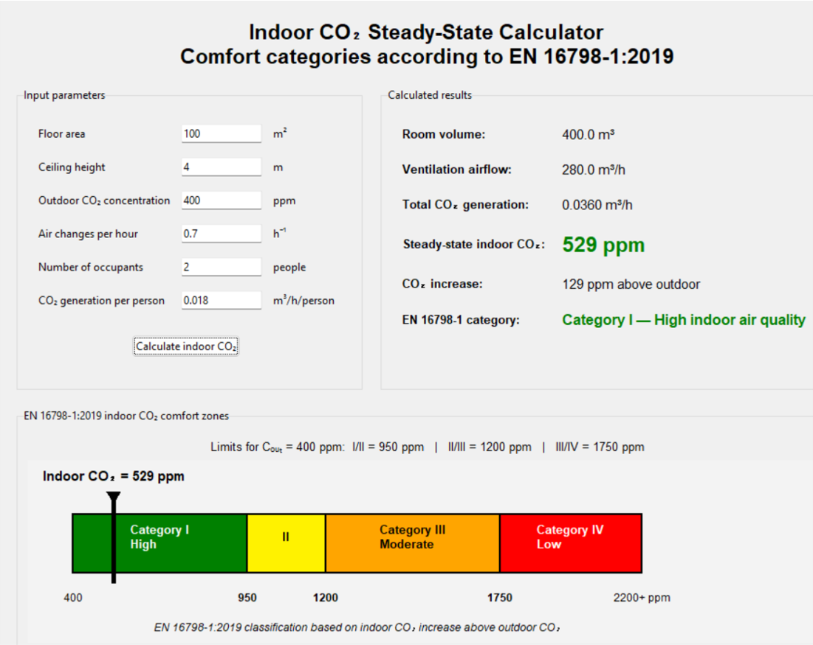

# About  
I built this website as an independent project in 2025–2026 to make an indoor-air-quality model easy for anyone to use. The model comes from the research of Dr. Anh Dung Tran Le (Université de Picardie Jules Verne), and the Python desktop version is the reference implementation developed under his guidance. Dr. Ngoc Khanh Nguyen (King's College London) advised on code design. — Minh Tran

# Indoor CO₂ Steady-State Calculator

A calculator for the steady-state indoor CO₂ concentration of a mechanically or
naturally ventilated room, classified against the comfort categories of
**EN 16798-1:2019**.

It exists in two forms that compute identical results:

- a **desktop application** in Python + Tkinter — [`IndoorCO2-steady_state.py`](IndoorCO2-steady_state.py)
- a **public website** — **<https://minhtranl.github.io/house-project/>**



---

## The model

The room is treated as a single **well-mixed zone** at steady state: occupants
release CO₂ at a constant rate, ventilation removes it at a constant rate, and
the concentration has settled to the point where the two balance exactly.

Under that assumption the transient mass balance

$$\frac{dC_{in}}{dt} = \frac{ACH}{V}(C_{out} - C_{in}) + \frac{G \cdot N}{V}$$

has `dC/dt = 0`, and collapses to a closed-form expression:

| Step | Formula | Units |
|---|---|---|
| Room volume | `V = A × H` | m³ |
| Ventilation airflow | `Q = ACH × V` | m³/h |
| Total CO₂ generation | `G_total = N × G_p` | m³/h |
| **Steady-state concentration** | **`C_ss = C_out + (G_total / Q) × 10⁶`** | ppm |

The factor 10⁶ converts the volume fraction into parts per million.

### Inputs

| Parameter | Symbol | Default | Unit |
|---|---|---|---|
| Floor area | A | 100 | m² |
| Ceiling height | H | 3 | m |
| Outdoor CO₂ concentration | C_out | 400 | ppm |
| Air changes per hour | ACH | 0.7 | h⁻¹ |
| Number of occupants | N | 2 | people |
| CO₂ generation per person | G_p | 0.018 | m³/h/person |

With these defaults: `V = 300 m³`, `Q = 210 m³/h`, `G_total = 0.036 m³/h`, and
**`C_ss = 571 ppm`** — 171 ppm above outdoor, which is Category I.

### Comfort categories

EN 16798-1:2019 classifies on the **CO₂ increase above outdoor**, `ΔC = C_ss − C_out`,
not on the absolute concentration. The thresholds are therefore relative and shift
with the outdoor level:

| Category | ΔC above outdoor | Description |
|---|---|---|
| **I** | ≤ 550 ppm | High indoor air quality |
| **II** | ≤ 800 ppm | Medium indoor air quality |
| **III** | ≤ 1350 ppm | Moderate indoor air quality |
| **IV** | > 1350 ppm | Low indoor air quality |

### Assumptions and limits

This is a steady-state model, so it answers *"where does the concentration
settle?"* and not *"how long does it take to get there?"*. It assumes:

- perfect mixing — no gradients or stratification within the room
- constant occupancy and a constant generation rate
- constant ventilation with outdoor air at a fixed concentration
- no other CO₂ sources or sinks (combustion, plants, adsorption)
- enough time has passed for transients to die out — roughly `3–5 × V/Q` hours,
  so about 4–7 hours at ACH = 0.7

For time-varying occupancy you need the transient form of the mass balance, which
is not implemented here.

---

## Repository layout

```
house-project/
├── IndoorCO2-steady_state.py   Desktop app (Python + Tkinter) — the reference model
├── web/                        The website
│   ├── index.html                Page structure
│   ├── style.css                 Layout and theming (light + dark, mobile)
│   ├── model.js                  The physics, ported from Python
│   ├── app.js                    Form, results panel, SVG gauge
│   ├── parity-test.html          Checks model.js against the Python original
│   ├── parity-cases.json         Generated test cases (do not edit by hand)
│   └── README.md                 Notes specific to the web version
├── tools/
│   └── generate_parity_cases.py  Regenerates parity-cases.json from the Python model
├── .github/workflows/deploy.yml  Publishes web/ to GitHub Pages on every push
└── references/                   Source papers behind the model
```

---

## Running it locally

### The desktop application

Needs only the standard library — Tkinter ships with CPython on Windows and macOS.

```bash
python IndoorCO2-steady_state.py
```

### The website

No build step and no dependencies. Serve the folder over HTTP:

```bash
python -m http.server 8000 --directory web
```

Then open <http://localhost:8000>.

Opening `web/index.html` directly as a `file://` path works for the calculator
itself, but the parity test needs `http://` because it fetches a JSON file.

---

## Keeping the two implementations honest

The model exists twice — once in Python, once in JavaScript — which creates a real
risk: a change to one that never reaches the other, producing a website that
quietly disagrees with the reference model.

A parity test closes that gap. [`tools/generate_parity_cases.py`](tools/generate_parity_cases.py)
runs the **Python** model across a grid of inputs and records every result:

> 4 floor areas × 3 ceiling heights × 3 outdoor levels × 4 ACH values
> × 5 occupancies × 3 generation rates = **2160 cases**

[`web/parity-test.html`](web/parity-test.html) then replays all 2160 through the
**JavaScript** and compares volume, airflow, generation, concentration and
category, to a tolerance of 1×10⁻⁹.

After changing the model **in either language**:

```bash
python tools/generate_parity_cases.py
```

then open <http://localhost:8000/parity-test.html> and confirm it reports PASS.
The test also runs against the deployed site at
[`/parity-test.html`](https://minhtranl.github.io/house-project/parity-test.html),
so the published version can be verified directly.

The script loads the reference model by executing only the part of
`IndoorCO2-steady_state.py` above the Tkinter section, so no window opens and
`tkinter` is never imported — it works on a headless machine too.

---

## How the site is published

`web/` is plain static files, so there is nothing to build and no server to run.
Publishing is handled by GitHub Pages:

1. A push to `main` triggers [`.github/workflows/deploy.yml`](.github/workflows/deploy.yml).
2. The workflow uploads the contents of `web/` as a Pages artifact.
3. GitHub serves it at <https://minhtranl.github.io/house-project/>.

Repository **Settings → Pages → Source** must be set to **GitHub Actions** for this
to run. Changes are live about a minute after a push.

Because every path in `index.html` is relative, the site works unchanged whether
it is served from a domain root, from the `/house-project/` sub-path, or from
`localhost`.

All calculation happens in the visitor's browser. Nothing is uploaded, and no
input is stored — so there is no database, no accounts and no personal data.

---

## References

## References

The model and comfort categories are based on:

1. Tran Le, A. D., Douzane, O., Promis, G., Samri, D., Roucoult, J.-M., Nguyen, A. T.,
   Lahoche, L., & Langlet, T. (2016). *A comparison of the effect of carbon dioxide and
   relative humidity sensitive ventilation systems on indoor air quality, hygrothermal
   and energy performance in an office room made of hemp concrete.* Proceedings of
   Indoor Air 2016, the 14th International Conference of Indoor Air Quality and Climate,
   Ghent, Belgium, July 3–8, 2016, Paper ID629.

2. Persily, A. K. (1997). *Evaluating building IAQ and ventilation with indoor carbon
   dioxide.* ASHRAE Transactions, 103(2).
   [NIST record](https://firedoc.nist.gov/article/53cyXYQBWEcjUZEYzsk4)

3. European Concerted Action "Indoor Air Quality & Its Impact on Man" (1992).
   *Report No. 11: Guidelines for Ventilation Requirements in Buildings.*
   Commission of the European Communities, Luxembourg, EUR 14449 EN.

4. CEN (2019). *EN 16798-1:2019 Energy performance of buildings — Ventilation for
   buildings — Part 1: Indoor environmental input parameters.*

---

## License

The code in this repository is released under the [MIT License](LICENSE).
The research papers and standard cited above remain the property of their
authors and publishers.
